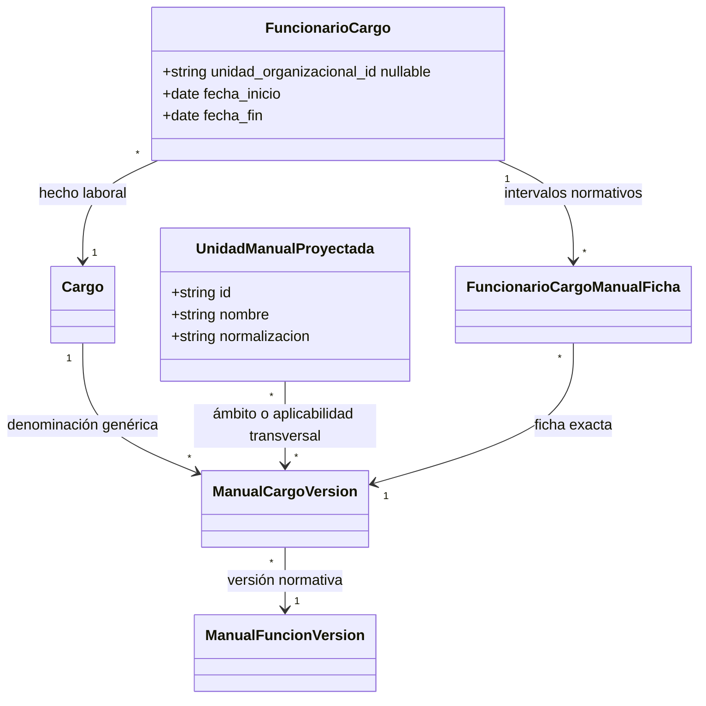

# Dependencia y selección de cargo

Fecha: 5 de octubre de 2026. Repositorio canónico: `C:/Users/mondr/source/labor-certification-recovery`.

## Modelo encontrado y decisión

No existía catálogo normalizado de unidades. `cargos.dependencia` y `funcionarios.dependencia` eran texto; `manual_cargo_versiones` ya conservaba `dependencia`, `area_funcional`, `source_id`, contenido original y hashes. Las tablas reales del Manual son `manuales_funciones` y `manual_funciones_versiones`, no `manual_versiones`.

`cargos` contiene denominaciones genéricas. `manual_cargo_versiones` contiene perfiles distintos para una misma denominación/código/grado. `funcionario_cargo` conserva el hecho laboral y `funcionario_cargo_manual_fichas` conserva sus relaciones normativas por intervalo. El formulario anterior cargaba todos los cargos y pedía elegir una ficha técnica. Su selección inicial se validaba contra el Manual actual, sin usar la fecha de ingreso.

Se evaluó la normalización persistida y se eligió una **proyección plana del Manual**, sin tabla nueva ni copia de fichas/cargos/funciones. `UnidadesManualService` deriva ámbitos únicos desde `area_funcional`; usa `dependencia` solo cuando no hay área y esta identifica un ámbito concreto. No interpreta segmentos como jerarquía ni corrige sinónimos institucionales. La denominación completa del área conserva el contexto de secretaría/dirección cuando la fuente lo incluye.

Normaliza solo espacios, mayúsculas y variantes tipográficas de guiones. La clave estable es MD5 del texto normalizado, calculada en PostgreSQL con parámetros enlazados para valores externos. No es un identificador de ficha ni una credencial. La respuesta del catálogo incluye nombre fuente y normalización; la ficha asociada conserva el original, `source_id`, hashes y versión. No se modifica el texto fuente ni el contenido publicado.

La única migración agrega `funcionario_cargo.unidad_organizacional_id`, nullable e indexada. Es una clave de la proyección, sin FK a un catálogo inexistente. No hace backfill ni escribe en tablas del Manual. No se creó nueva entidad persistida; el diagrama siguiente documenta la proyección y el atributo añadido.

## Resolución e integridad

La combinación **unidad + cargo activo + fecha + versión publicada aplicable** debe producir exactamente una ficha. Cero candidatas causa rechazo; varias también, aunque el cliente suministre un ID de ficha. No se ordena por ID para resolver. Una ficha incompleta pero con ámbito fiable puede asociarse: su incompletitud sigue bloqueando únicamente el certificado con funciones mediante el resolver existente.

La creación usa `fecha_ingreso`; la sustitución administrativa usa hoy, como el controlador anterior. El catálogo de edición recibe `fecha_seleccion` del servidor. Se conserva la excepción normativa existente para la versión 10 publicada sin fecha de inicio. Cierre de versiones y fechas finales siguen aplicando. El selector inicial consulta hoy hasta que se informa la fecha de vinculación; cambiarla en alta limpia la selección para volver a resolver.

La dependencia textual del funcionario se escribe desde la unidad elegida y validada por el servidor, incluso cuando la ficha tiene aplicabilidad transversal. La API rechaza texto libre en ese campo. Los Form Requests aceptan únicamente valores administrativos validados; los datos de unidad/ficha se excluyen del mass assignment de `Funcionario`. Un ID de ficha enviado por un cliente externo se trata solo como afirmación a comprobar contra el resultado único, nunca como criterio de elección.

Los endpoints heredan autenticación, revisión de identidad, contraseña cambiada, MFA y throttle autenticado. Requieren permiso `funcionarios.crear` o `funcionarios.editar`. El autoservicio no accede a ellos; los permisos de create/update del funcionario se conservan.

## API y formulario

- `GET /api/v1/manual-funciones/dependencias?fecha=YYYY-MM-DD&q=...`: catálogo compacto de ámbitos publicados aplicables. Búsqueda opcional en servidor; el formulario filtra por nombre el catálogo compacto ya cargado.
- `GET /api/v1/manual-funciones/dependencias/cargos?unidad_organizacional_id=...&fecha=...&q=...`: cargos resumidos filtrados en SQL, búsqueda por denominación/código/grado, `per_page` entre 1 y 100 y paginación con el envelope actual. Incluye cantidad de perfiles para advertir ambigüedad. No carga funciones ni fichas completas, ni ejecuta consultas por opción.
- `GET /api/v1/manual-funciones/dependencias/resolver?unidad_organizacional_id=...&cargo_id=...&fecha=...`: resolución para confirmación de solo lectura, con source ID y cantidad de funciones. No devuelve contenido normativo completo.
- `POST/PUT /api/v1/funcionarios`: nuevos datos laborales usan `unidad_organizacional_id` y `cargo_id`. El backend repite la resolución dentro de la transacción. La API anterior de fichas permanece para consulta/compatibilidad, pero el formulario no la usa.

La interfaz usa selects nativos con búsqueda etiquetada, accesibles por teclado, sin popovers que puedan quedar recortados. Un texto de búsqueda nunca se convierte en valor seleccionado. Cargo inicia deshabilitado. Cambiar dependencia limpia inmediatamente cargo, búsqueda de cargo y confirmación de perfil; cambiar la búsqueda de cargo también invalida su selección. Loading, vacío, error y reintento tienen mensajes controlados. El perfil es información de lectura; no se pide versión, ficha, ID normativo ni funciones individuales.

## Edición e históricos

### Presentación de condiciones del Manual

La resolución y el guardado por unidad conservan HTTP **422**, con `errors.cargo_id` y un `code` estable: `MANUAL_FICHA_AMBIGUA` para varias candidatas y `MANUAL_FICHA_NO_ENCONTRADA` para cero. Se reutilizan los nombres de dominio existentes. No se devuelven candidatas ni funciones completas; la respuesta exitosa conserva solo `source_id` y `funciones_count`.

La ambigüedad es una condición **no retryable**. El formulario muestra **«Este cargo requiere revisión del Manual»** y explica que no puede seleccionar automáticamente funciones potencialmente incorrectas. **«Elegir otro cargo»** limpia cargo, búsqueda y confirmación del perfil, conserva dependencia y datos personales, y devuelve foco al selector de cargo. **«Cambiar dependencia»** limpia también dependencia y búsquedas, y devuelve foco a su selector. El mensaje inline tiene `role="alert"`, está asociado al cargo y al botón de guardar mediante `aria-describedby`, y usa tratamiento informativo institucional.

**«Reintentar» se reserva para fallos técnicos** de consulta: conexión sin respuesta, timeout, HTTP 5xx, 408 o 429. Los códigos del Manual tienen prioridad sobre HTTP y no ofrecen retry; las demás respuestas 4xx tampoco. La validación de campos requeridos no ofrece reintentar la carga de selectores. Cero candidatas tiene un mensaje distinto: «No se encontró un perfil del Manual compatible con este cargo, dependencia y fecha».

El botón de guardar queda deshabilitado mientras no haya resolución única confirmada; el submit también comprueba ese estado. Una ambigüedad que aparece en la validación del guardado se muestra con las mismas acciones. La resolución normativa no se delega al usuario: no existe selección de fichas ni preferencia entre perfil específico y transversal. Las combinaciones ambiguas siguen bloqueadas. Una edición personal conserva su ficha exacta registrada aunque el catálogo actual sea ambiguo, tanto en relaciones legacy como en relaciones con unidad persistida.

Una ficha incompleta con ámbito fiable sigue pudiendo asociarse conforme al comportamiento previo; esta mejora no cambia las reglas de completitud para certificados. Los códigos existentes de ficha incompleta, incompatible y Manual no vigente, cuando son devueltos, se presentan sin retry.

La precarga identifica la ficha mediante la relación normativa aplicable hoy; solo usa la referencia legacy cuando no existen relaciones normativas. La unidad registrada se lee desde la clave persistida, incluso si la ficha es transversal. La unidad legacy se presenta como proyección de su ficha exacta, sin escribirla en el historial; una ficha transversal legacy sin clave de unidad no se asigna a una unidad por inferencia. El texto libre histórico se muestra explícitamente en lectura. Cuando no hay ficha/ámbito fiable, se muestra la dependencia histórica conservada y se requiere una selección explícita para reemplazar la vinculación. No se infiere una relación por denominación o texto libre del funcionario.

Una edición sin cambiar dependencia/cargo omite esos IDs del payload y conserva la ficha e intervalos, incluso si actualmente el catálogo muestra nuevas ambigüedades o ya no ofrece la ficha anterior. Cambiar la vinculación cierra la asignación laboral anterior en ayer y crea otra desde hoy; sus relaciones normativas anteriores permanecen intactas. Se mantiene la protección contra sustituciones en el mismo día. No se transforma una asignación legacy en otra retroactivamente para simplificar el formulario.

Los certificados continúan usando sus servicios existentes: `sencillo` depende del hecho laboral; `funciones` usa la ficha exacta asociada y valida completitud/vigencia. No se modificó PDF, snapshot, QR documental, firma, oficialización, pagos, cuotas ni flujo del funcionario. El PDF conserva **BORRADOR — SIN VALIDEZ OFICIAL**. Fase 3B.2 no iniciada.

## Ambigüedades y límites de la fuente

La proyección actual deriva **73 ámbitos concretos de 335 fichas**. La auditoría de la versión 10 detecta **50 combinaciones de ámbito/cargo con varias fichas**. Son 48 ambigüedades entre perfiles específicos y dos adicionales al considerar los perfiles transversales explícitos. Se muestran como cargos que requieren revisión y su resolución/guardado falla explícitamente. Para habilitarlas se necesita evidencia institucional adicional que distinga el perfil; no se inventaron etiquetas funcionales ni se habilitó un selector técnico como atajo.

Los ocho perfiles cuyo ámbito fuente es exactamente `Todas las dependencias` se ofrecen como cargos transversales dentro de cada unidad concreta existente y aplicable. Esa aplicabilidad está explícita en el Manual: no se crea una dependencia con ese nombre, no se copian perfiles y no se ofrece un perfil transversal si el ID de unidad no existe. Una coincidencia de perfil transversal y específico también causa rechazo por ambigüedad. MF-0167 (`Donde se ubique el cargo`, área y propósito vacíos) sigue fuera de nuevas selecciones porque no hay unidad verificable; no se completa. Sus vinculaciones existentes siguen disponibles para lectura/edición conservadora y certificación conforme a las reglas previas. Variantes semánticas como nombres con/sin artículos o tildes permanecen separadas; requieren revisión institucional para fusionarlas.

`scripts/dependency_manual_integrity.sql` registra conteos, versión, MF-0167, claves agrupadas y todas las ambigüedades usando una transacción de solo lectura. Las pruebas de dominio y E2E usan perfiles sintéticos y no cambian el Manual real para construir casos.
