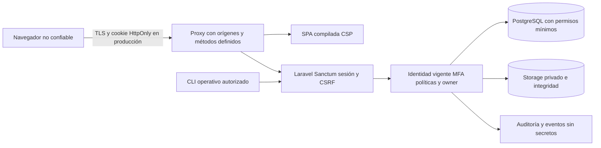

# Modelo de amenazas — fase 2.9

Revisión técnica local, 2026-10-04. No evaluación del entorno institucional ni certificación ASVS. Activos: identidad, credenciales, factores MFA, registros laborales, Manual publicado, cuotas, solicitudes, comprobantes privados, snapshots/PDF borrador, auditoría, APP_KEY y backups.

Límites de confianza: browser→proxy (inputs, cookies y headers no implican confianza); proxy→PHP (solo IPs explícitas pueden afirmar HTTPS/IP); API→DB (consultas ligadas y constraints); API→filesystem (rutas internas, no nombres suministrados); eventos→operaciones (acceso/retención institucional); CI/build→artefacto (lockfiles, dependencias dev y fuentes confiables). CT HTTP/DB postgres no representan producción.

STRIDE organiza los casos de la tabla siguiente: **suplantación** (credenciales, MFA y sesiones), **alteración** (uploads, storage y campos privilegiados), **repudio** (acciones administrativas y de pagos, con auditoría de actor), **divulgación** (IDOR, XSS, errores, logs y configuración), **denegación de servicio** (fuerza bruta, tamaño de requests y tooling) y **elevación de privilegios** (permisos, roles y bypass del segundo factor). La auditoría local reduce el repudio; su retención y protección operativa requieren D03 y no constituyen prueba de no repudio legal.

| Amenaza / actor | Abuso | Control comprobable | Riesgo residual / dueño |
|---|---|---|---|
| Anónimo con documento laboral | Apropiarse de cuenta antes del primer cambio | Primer ingreso limitado y sin negocio, respuesta genérica, cambio obligatorio | HIGH D01: activar mediante canal verificado; Talento Humano |
| Credential stuffing / spraying | Repetir passwords y TOTP | IP + identidad + pareja temporales, límites por factor/contexto, eventos | Ataque distribuido y DoS de identidad; monitoreo/edge |
| Password backoffice robada | Entrar al panel antes de MFA | Principal pendiente 10 min sin guard, TOTP/recovery, MFA obligatorio | Phishing y dispositivo comprometido; capacitación, futuro factor resistente a phishing |
| Código TOTP/recovery capturado | Replay / doble consumo | Paso monotónico con ventana ±1, bloqueo de fila y sesión, códigos aleatorios de uso único hashed | APP_KEY/DB comprometidos; custodia/backups |
| Sitio externo | CSRF / credenciales CORS | Middleware oficial exige token, Origin exacto, Lax, sin wildcard | XSS mismo origen puede ejecutar acciones; CSP/escaping |
| XSS en texto laboral | Robar sesión / ejecutar HTML | JSX/Blade escaping, script-src self sin eval, sesión HttpOnly | HttpOnly no impide acciones de XSS; styles inline admitidos |
| Funcionario A | Leer/alterar solicitud, recibo o PDF de B | Contexto funcionario, titular, binding compuesto, policies | Revisar cualquier ruta nueva contra matriz |
| Secretaría / admin malicioso | Elevar rol, saltar pago, resetear factores | Permisos explícitos, campos allowlist, step-up 5 min, otro admin y último admin, auditoría | Insider autorizado: segregación y monitoreo institucional |
| Sesión obsoleta | Revivir acceso tras desactivar/reset/rol | auth_version y estado revalidados; tokens borrados; invalidación cookie | Cambios directos DB deben ejecutar proceso de revocación |
| Payload SQL/shell/path/URL | Consultar DB arbitraria, leer filesystem, SSRF | Binds + sort allowlist, sin shell/HTTP dinámico, UUID privado, Dompdf remote/PHP off | Nuevas integraciones requieren nueva evaluación |
| Upload hostil | Ejecutable, PDF malicioso, agotamiento | MIME/extensión real, 5 MiB, firmas mínimas, imagen decodificable, UUID, attachment, hash | PDF parser no certifica contenido benigno; AV/sandbox futuro |
| Robo/alteración de storage | Distribuir archivo modificado | SHA256 antes de descarga, 409 y evento, storage privado | Backups cifrados y permisos OS requieren infraestructura |
| Error de despliegue | Debug, CORS amplio, default DB, cookies inseguras | Check-config y middleware prod fail closed; ini/Nginx | TLS, roles DB reales y distribución de secretos aún no desplegados |
| Dependencia/build comprometido | Supply chain / DoS del tooling | Lockfiles, audit, parches compatibles, build aislado | HIGH dev braces; D08, no compilar globs de terceros |
| Excepción/log injection | Filtrar SQL/passwords o falsificar líneas | Errores genéricos, eventos allowlist, CRLF normalizado | Centralización/alertas/retención y acceso externo pendientes |

No JWT, OAuth/OIDC, WebRTC, GraphQL, SMS, email recovery ni preguntas de seguridad en el alcance. API tokens solo capacidad CLI opt-in, sin emisión HTTP al browser. No backdoor de emergencia HTTP. Un segundo administrador con factor operativo y recuperación custodiada es requisito institucional.
